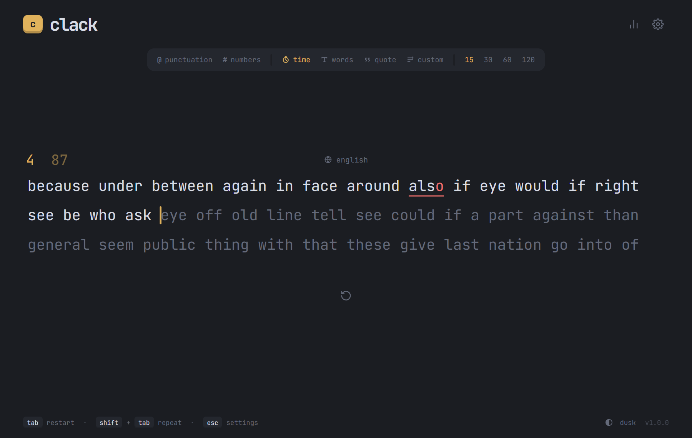
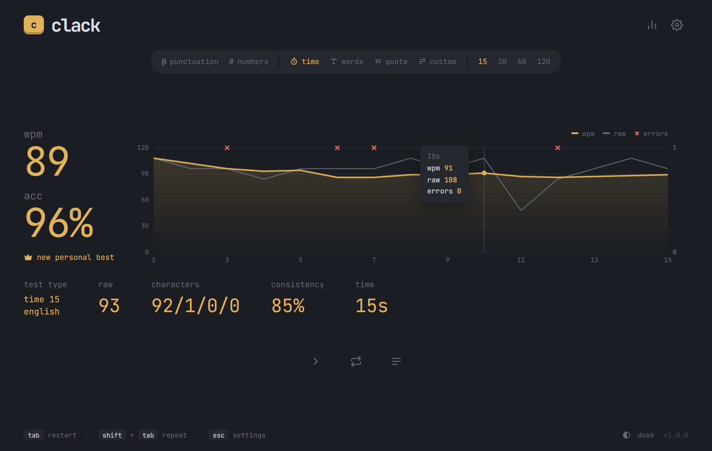
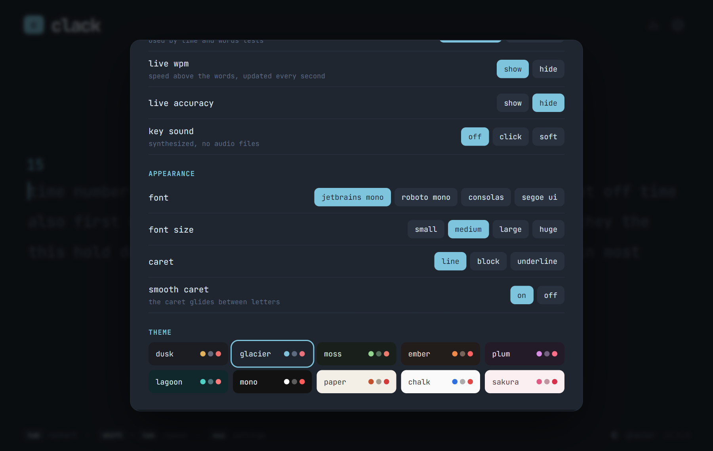
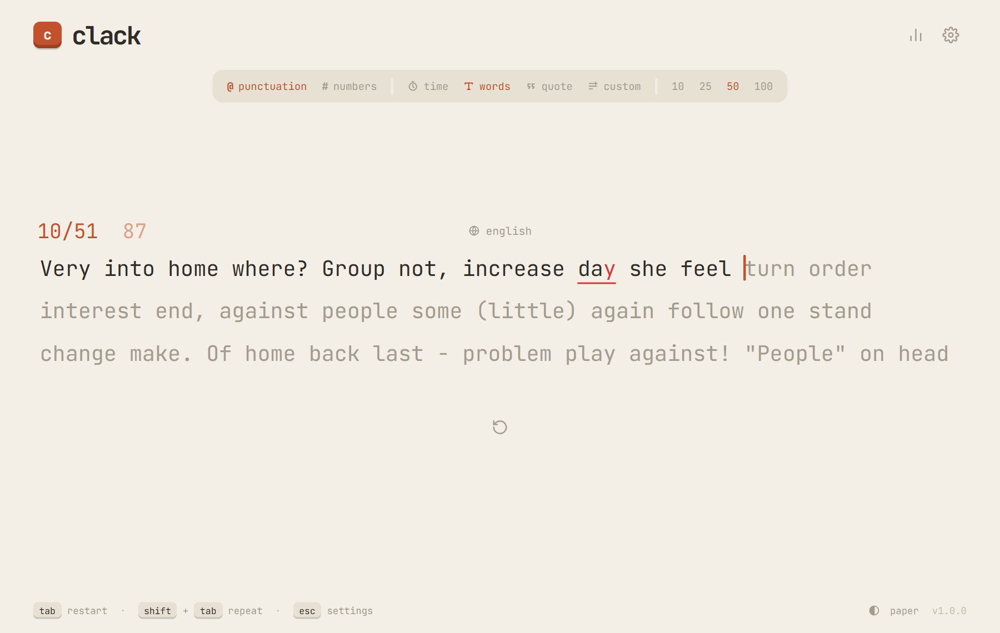

<h1 align="center">clack</h1>

<p align="center">A fast, offline, minimalist typing test for Windows.</p>

<p align="center">
  <a href="https://github.com/mayank-92829/clack/releases/latest"><b>Download for Windows</b></a>
</p>





## Features

- **Modes**: time (15 / 30 / 60 / 120 s), words (10 / 25 / 50 / 100), quotes (short / medium / long) and your own custom text.
- **Punctuation and numbers** toggles, with English 200 and English 1k word lists. Words never repeat back to back.
- **While you type**:
  - The caret glides between letters.
  - Lines scroll smoothly as you go.
  - Live WPM shows above the words.
  - Everything else fades away until you move the mouse.
- **Results**:
  - WPM, accuracy, raw WPM, consistency, and characters (correct / incorrect / extra / missed).
  - A per-second chart with errors.
  - The words you typed, with mistakes underlined.
- **Personal bests** per test type, plus a stats page with your recent tests.
- **Customization**: 10 themes, 4 fonts, caret styles and optional key sounds.
- **Small and private**: a 1.3 MB installer and about 30 MB of memory while running. It works completely offline, and everything stays on your computer.





## Download

Get **`Clack_<version>_x64-setup.exe`** from [Releases](https://github.com/mayank-92829/clack/releases/latest). It installs per user and doesn't need admin rights.

**`Clack_<version>_x64_portable.exe`** is also there as a portable build that needs no install.

It needs Windows 10 or 11 with WebView2, which Windows 11 includes; the installer adds it if it's missing.

## Keys

| | |
|---|---|
| `Tab` | new test (also from the results screen) |
| `Shift+Tab` | repeat the same test |
| `Enter` | next test, on the results screen |
| `Esc` | settings |
| `Ctrl+Backspace` | delete the whole word |

You can go back into a previous word only if it has a mistake. Click the word list name above the words to switch lists.

## How results are counted

- **WPM**: characters in correctly typed words (plus their spaces) ÷ 5 ÷ minutes.
- **Raw**: every character typed, right or wrong, ÷ 5 ÷ minutes.
- **Accuracy**: correct keystrokes ÷ all keystrokes. Mistakes you fixed still count.
- **Consistency**: how steady your raw speed was from second to second.

Tests shorter than 2 seconds or under 50% accuracy are not saved.

## Documentation

- [docs/ARCHITECTURE.md](docs/ARCHITECTURE.md): how everything works, including the typing engine, caret, line scrolling, stat formulas, text generation, storage and the desktop shell.
- [docs/DEVELOPMENT.md](docs/DEVELOPMENT.md): setup, build, release steps, how to add themes, quotes, word lists and settings, and a step-by-step path to rebuild the app yourself.
- [CHANGELOG.md](CHANGELOG.md)

## Build

You need Node 20+, Rust and the Visual Studio Build Tools (full setup in [DEVELOPMENT.md](docs/DEVELOPMENT.md)).

```bash
npm install
npm run tauri dev      # run in development
npm run tauri build    # app + installer in src-tauri/target/release/
```

`npm run dev` alone serves the app at http://127.0.0.1:1430 in a browser.

```
src/main.ts       typing engine, results, config bar, settings / stats / custom text panels
src/generator.ts  random words with punctuation and numbers, quote picker, custom text cleanup
src/words.ts      word lists
src/quotes.ts     quotes
src/chart.ts      results chart (canvas)
src/themes.ts     themes
src/sound.ts      synthesized key sounds
src-tauri/        the Windows app shell (Tauri 2)
```

## License

MIT
